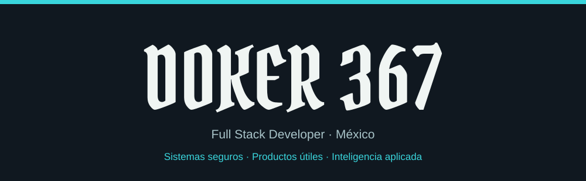

  
   
  <a href="#featured-projects">Ver proyectos</a> &nbsp;·&nbsp;
  <a href="mailto:blcdoker@gmail.com">Escribirme</a>

## Sobre mí

Desarrollador Full Stack con enfoque en **arquitecturas escalables**, **ciberseguridad** y **machine learning**. Construyo desde sistemas POS y e-commerce hasta motores de detección de fraude con deep learning y GPUs. Creo firmemente que el buen software nace de la intersección entre código limpio, seguridad desde el diseño y resolución de problemas reales.

## Tech Stack

- **Languages:** JavaScript · TypeScript · Python · Dart · Go · Java · C#
- **Frontend:** React · Flutter · Vite · Tailwind CSS · Handlebars
- **Backend:** Node.js · Express · FastAPI · Gin · .NET · GraphQL
- **Data & ML:** PyTorch · TensorFlow · PostgreSQL · Firebase · SQLite
- **DevOps & Tools:** Docker · Kubernetes · Linux · Git · Streamlit · Ollama

## Featured Projects

### GreenFraudShield · Detección de fraude

Sistema inteligente de evaluación de riesgo de fraude con IA local. Combina **Autoencoder (PyTorch + CUDA)**, **Isolation Forest** y **XGBoost**, con explicabilidad mediante **LLaMA 3** vía Ollama.

- API dual: FastAPI y Go (Gin) para alto rendimiento.
- Dashboard Streamlit con interfaz de entrenamiento en tiempo real.
- AUC-ROC combinado reportado en el proyecto: **0.93–0.97**.
- Siete patrones de fraude simulados, incluidos *velocity*, *impossible travel* y VPN.

[Ver repositorio de GreenFraudShield →](https://github.com/Doker367/GreenFraudShield) · `PyTorch` `XGBoost` `CUDA` `Go` `FastAPI` `Streamlit` `Ollama`

### Punto de venta UNACH

Proyecto de punto de venta en Python orientado a **ventas e inventario**. Su documentación también contempla gestión de clientes, reportes y control de acceso por roles.

[Ver repositorio del punto de venta →](https://github.com/Doker367/punto-de-venta) · `Python` `PostgreSQL`

### ManyBox Enviox

Sistema completo de **ManyBox Enviox** para su operación de envíos. El proyecto está vinculado al dominio proporcionado por su autor; sus detalles internos no se publican aquí.

[Visitar manyboxenviox.com →](https://manyboxenviox.com/)

### TrimoStyle

Plataforma de gestión para barberías con **agenda, clientes, barberos, inventario y ventas**. Permite administrar sucursales, roles y reportes desde un mismo producto.

[Explorar trimostyle.com →](https://trimostyle.com/)

### LARCAD · UNACH

Sitio del **Laboratorio Regional de Cómputo de Alto Desempeño de la UNACH**. Su repositorio público de interfaz utiliza React y Vite, con recursos 3D mediante Three.js y React Three Fiber.

[Visitar larcad.mx →](https://larcad.mx/) · [Ver repositorio →](https://github.com/Doker367/LARCAD-nuevo)

### GreenPOS — Soft Restaurant

Sistema completo de gestión para restaurantes desarrollado con **Flutter y Clean Architecture**. Incluye módulos para clientes y administradores, con diseño responsivo para móviles y tablets.

- Menú por categorías con fotos y carrito en tiempo real.
- Panel administrativo para productos, pedidos, mesas y reservas.
- Autenticación y datos con Firebase; almacenamiento local con SQLite.
- Temas claro y oscuro, Riverpod y GoRouter.

[Ver GreenPOS →](https://github.com/Doker367/GreenPOS) · [Ver backend Go/GraphQL →](https://github.com/Doker367/GreenPOS_backend) · `Flutter` `Dart` `Riverpod` `Firebase` `SQLite`

### Cielo y Tierra — POSH

E-commerce para bebidas tradicionales de Chiapas con **Express y PostgreSQL**, interfaz en **React y Tailwind CSS**, y vistas renderizadas con Handlebars.

[Ver repositorio →](https://github.com/Doker367/Cielo-y-Tierra-POSH) · `Node.js` `PostgreSQL` `React`

### Dystopia Music

Reproductor de música para Android desarrollado en Flutter, con reproducción offline, motor DSP nativo, ecualizador, búsqueda y widgets para Android.

[Ver repositorio →](https://github.com/Doker367/dystopia-music) · `Flutter` `Dart` `Riverpod` `just_audio` `Hive`

## GitHub Milestones

  <picture>
    <source media="(max-width: 600px)" srcset="https://raw.githubusercontent.com/Doker367/Doker367/output/milestones-mobile.svg" />
    
  </picture>

## Enterprise Development Analytics

  <picture>
    <source media="(max-width: 600px)" srcset="https://raw.githubusercontent.com/Doker367/Doker367/output/stats-mobile.svg" />
    
  </picture>

## Pac-Man en mis contribuciones

  <a href="https://github.com/Doker367?tab=overview">
    <picture>
      <source media="(max-width: 600px)" srcset="https://raw.githubusercontent.com/Doker367/Doker367/output/pacman-mobile.svg" />
      
    </picture>
  </a>

Los gráficos se generan con datos de GitHub y se actualizan diariamente. Si tu visor no reproduce el SVG, [consulta la actividad directamente en GitHub](https://github.com/Doker367?tab=overview).

## Hablemos

¿Tienes una idea, una colaboración o un problema interesante? **[Escríbeme a blcdoker@gmail.com](mailto:blcdoker@gmail.com)** o explora [todos mis repositorios](https://github.com/Doker367?tab=repositories).

  

